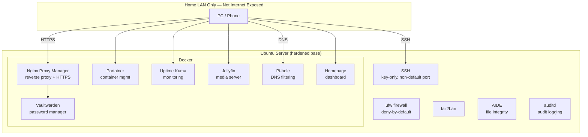

# Hardened Linux Server Lab

A Linux server built from scratch on repurposed hardware: a minimal Ubuntu Server install, hardened against CIS-style benchmarks with Lynis, and expanded into a self-hosted Docker homelab.

This is a real, running project, not a tutorial writeup. It includes the mistakes, the incident recovery, and the things I deliberately chose not to fix, alongside what worked.

---

## What This Is

| | |
|---|---|
| **Hardware** | Repurposed laptop (Intel i7-11800H, 14GB RAM) |
| **OS** | Ubuntu Server LTS, minimal/headless install |
| **Purpose** | A documented, benchmarked hardening project expanded into a functioning self-hosted service platform |

Full technical writeup, including every incident and the reasoning behind every security tradeoff, is in **[HARDENING.md](./HARDENING.md)**.

---

## Architecture



---

## Tech Stack

| Layer | Tools |
|---|---|
| **OS hardening** | ufw, fail2ban, SSH key auth, AIDE, auditd, Lynis |
| **Containerization** | Docker, Docker Compose |
| **Reverse proxy / HTTPS** | Nginx Proxy Manager, self-signed certificates |
| **Monitoring** | Uptime Kuma |
| **Services** | Vaultwarden (secrets), Jellyfin (media), Pi-hole (DNS), Portainer (container mgmt), Homepage (dashboard) |

---

## Repository Structure

```
linux-server-lab/
├── README.md                  ← you are here
├── HARDENING.md                ← full hardening writeup, incidents, and reasoning
├── LICENSE
├── docker/
│   ├── docker-compose.yml      ← the full homelab stack
│   └── .env.example            ← required environment variables (copy to .env)
├── security/
│   ├── ssh/sshd_config.snippet ← the hardened SSH directives, not the full file
│   ├── fail2ban/jail.local
│   ├── audit/audit.rules
│   ├── sysctl/99-hardening.conf
│   └── ufw-baseline.sh         ← idempotent script to reapply firewall rules
└── docs/
    └── lynis-findings.md        ← full list of addressed and deliberately skipped findings
```

---

## Quick Start

This isn't meant to be blindly run against a production box; it documents one specific machine. That said, the pieces are reusable:

```bash
git clone https://github.com/yourusername/linux-server-lab.git
cd linux-server-lab

# Review and copy the environment template
cp docker/.env.example docker/.env
nano docker/.env    # fill in your own values

# Review the firewall baseline before running it — it assumes specific ports
cat security/ufw-baseline.sh
sudo bash security/ufw-baseline.sh

# Bring up the service stack
cd docker
docker compose up -d
```

---

## Sanitization Policy

This is a public repository. Real internal IP addresses, the actual SSH port in use, generated password hashes, and any device-specific identifiers have been replaced with placeholders (e.g. `[laptop-LAN-IP]`) throughout. Config snippets are excerpts of the relevant hardening lines, not full unmodified files pulled from the live server.

---

## Key Incident: GRUB Bootloader Lockout

Implementing a GRUB boot password went wrong due to a hash typo, locking the server out entirely after a power loss. Recovered via a live-USB LVM chroot repair, then deliberately removed the control afterward rather than re-fixing it, given the availability risk it posed for an unattended server. Full writeup with every step in **[HARDENING.md](./HARDENING.md#incident-grub-bootloader-password-lockout)**.

---

## License

MIT — see [LICENSE](./LICENSE).
